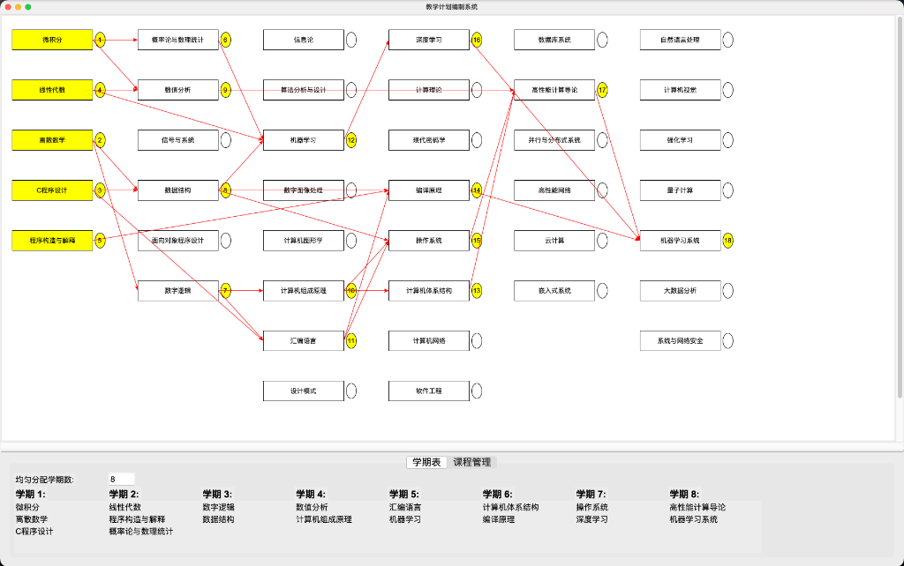

# Syllabus - 教学计划编制系统

基于有向无环图（DAG）与拓扑排序的本科课程修读规划与可视化工具，使用 Python、Tkinter 与 NetworkX 构建。



## 功能特性

- **课程先修关系可视化**：按阶段分层展示课程 DAG，区分已修读（绿）、可直接修读（黄）与未修读（白）状态。
- **目标课程路径分析**：点击任意课程右侧圆形标记，高亮显示该课程的完整先修依赖子图，并按拓扑顺序编号展示待修路径。
- **修读进度联动管理**：点击课程矩形切换修读状态，自动递归补全前置课程或重置受影响的后继课程，并自动保存进度。
- **学期均匀排课**：在底部「学期表」中输入目标学期数，自动将目标路径上的待修课程均匀分配到各学期。
- **课程维护与多套方案切换**：支持查找、添加、删除课程，并可通过菜单 `文件 > 导入` 切换不同专业/高校的 JSON 课程方案。

## 内置课程方案

- `data.json`：融合理论与系统双线主干的计算机科学与技术课程 DAG（40 门课，覆盖数学基础、系统底层、AI、高性能计算与网络等方向，最长依赖链不超过 6 学期）。
- `ncucs_data.json`：南昌大学计算机系参考课程方案（38 门课）。
- `math_data.json`：数学系课程方案示例（16 门课）。

## 快速开始

推荐使用 [uv](https://docs.astral.sh/uv/) 运行（需要 Python 3.12+ 与内置 Tkinter）：

```bash
uv sync
uv run main.py
```

或使用标准 Python 虚拟环境：

```bash
python3 -m venv .venv
source .venv/bin/activate
pip install networkx
python main.py
```

## 项目结构

```text
.
├── main.py           # 主程序入口与事件交互
├── gui.py            # Tkinter 窗口、画布与选项卡布局
├── graph.py          # NetworkX 有向图构建与分层布局
├── logic.py          # 递归状态传播与学期分配逻辑
├── data.py           # JSON 课程数据读写
├── data.json         # 默认计算机课程 DAG
├── ncucs_data.json   # 参考计算机课程 DAG
├── math_data.json    # 数学系课程 DAG
├── pyproject.toml    # uv 项目配置
└── uv.lock           # 依赖锁文件
```

## License

MIT
